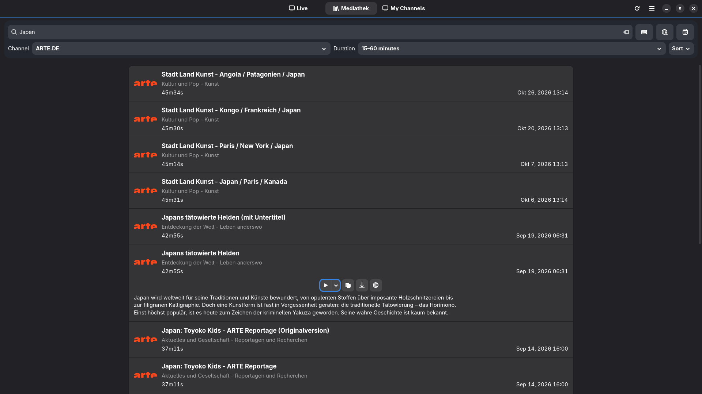
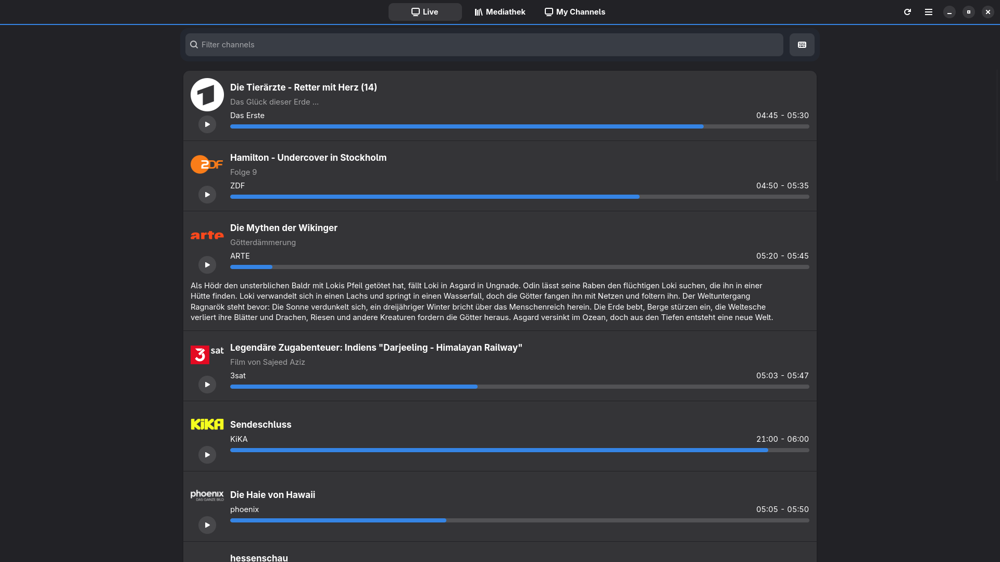
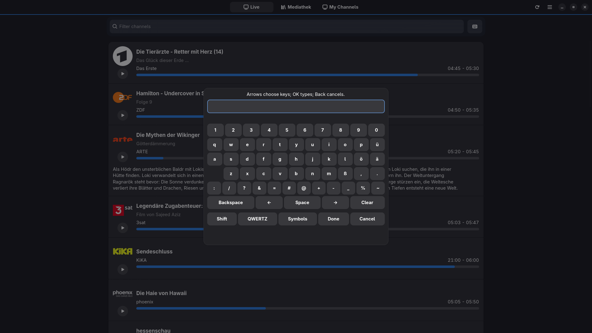
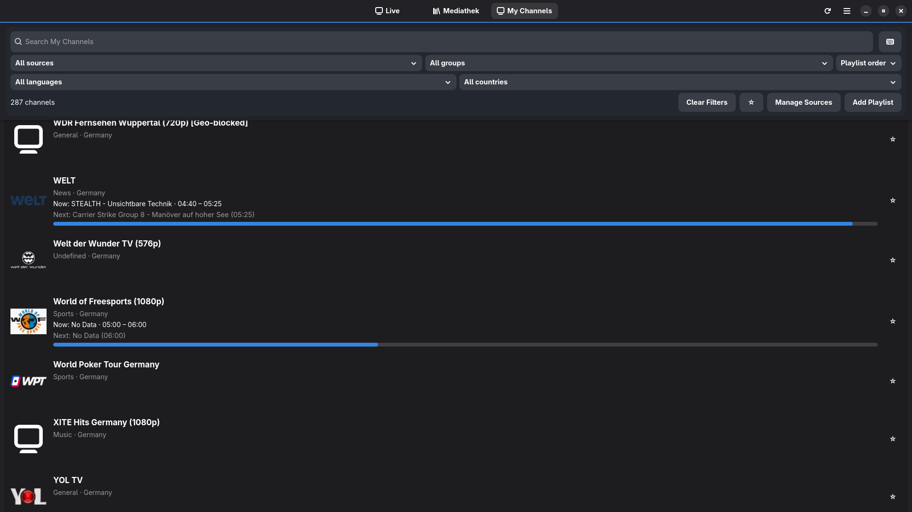
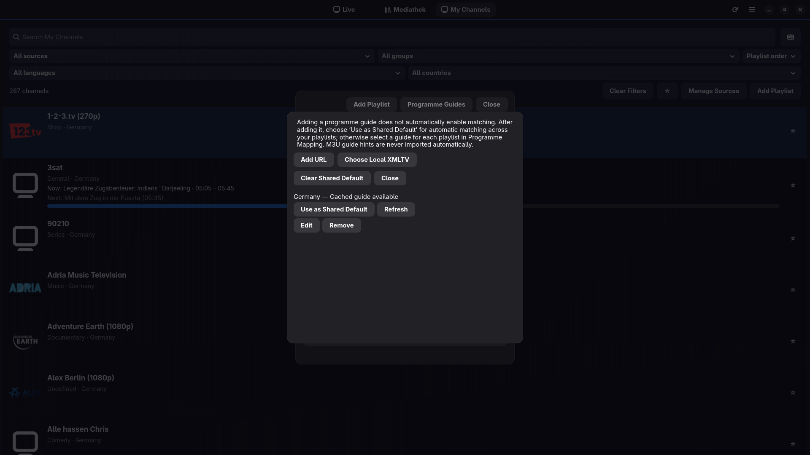

<!-- SPDX-FileCopyrightText: David Cabot <d-k-bo@mailbox.org> -->
<!-- SPDX-FileCopyrightText: 2026 Televido contributors -->
<!-- SPDX-FileCopyrightText: 2026 Broadcaster contributors -->
<!-- SPDX-FileContributor: Claude (Anthropic) -->
<!-- SPDX-License-Identifier: GPL-3.0-or-later -->

# Broadcaster

**[English](README.md) | Deutsch**

Broadcaster ist eine schlanke, native Linux-Anwendung für öffentlich-rechtliches Live-TV, Mediathek-Sendungen und eigene M3U-/IPTV-Sender. Die Wiedergabe erfolgt mit mpv. Optionale XMLTV-Programmführer liefern **Jetzt/Nächste-Informationen** für eigene Sender; **Favoriten** erleichtern den Überblick. Die GTK4-/libadwaita-Oberfläche funktioniert mit Maus, Tastatur und Richtungsfernbedienungen, auch unter Wayland/KDE Plasma Bigscreen.

## Funktionen

- **Mediathek:** Suche über MediathekViewWeb, Sender- und Dauerfilter, Sortierung, Qualitätsauswahl und Sendungsdetails.
- **Live-TV:** laufende Programme aus dem Zapp-Katalog mit Sendungsbeschreibungen sowie konfigurierbarer Senderauswahl und -reihenfolge.
- **Eigene Sender (neu in v0.2.0):** Lokale M3U-Dateien oder HTTP(S)-Playlistadressen hinzufügen, mehrere Quellen verwalten und Playlists manuell aktualisieren, nach Gruppe/Sprache/Land/Region filtern, Sendermetadaten dauerhaft bearbeiten und Streams über die bestehende mpv-Steuerung abspielen. Senderlogos werden nur bei Bedarf geladen und können durch ein Standardsymbol ersetzt werden.
- **XMLTV-Programmführer (v0.2.5):** Mehrere XMLTV-Quellen aus lokalen Dateien oder ausdrücklich gewählten HTTP(S)-Adressen hinzufügen. Programmführer manuell oder nach einem optionalen Zeitplan automatisch aktualisieren (beim Hinzufügen standardmäßig aktiviert). Einen Programmführer als **Shared Default** für Playlists auswählen oder einer bestimmten Playlist zuordnen. Allein das Hinzufügen ordnet ihn keiner Playlist zu.
- **Programmführer pro Playlist (v0.3.0):** Jede Playlist kann den Shared Default übernehmen, einen bestimmten Programmführer verwenden oder EPG-Informationen ausdrücklich deaktivieren. Andere Playlists bleiben davon unberührt.
- **Automatische Playlist-Aktualisierung (v0.3.0):** Getrennt pro Quelle aktivierbar, standardmäßig ausgeschaltet, mit einem Intervall von 6–168 Stunden. Fällige Playlists werden nur bei laufender Anwendung geprüft; unerwartet starke Senderverluste benötigen eine manuelle Bestätigung.
- **Datenbanksicherung und Wiederherstellung (v0.3.0):** Eine konsistente SQLite-Sicherung in einen gewählten Ordner exportieren. Eine kompatible Sicherung wird erst nach ausdrücklicher Bestätigung und Neustart als vollständiger Ersatz eingespielt; die vorherige Datenbank bleibt zur Wiederherstellung erhalten.
- **Jetzt/Nächste und Senderzuordnung (v0.2.5):** Laufende und folgende Sendungen anzeigen, wenn ein Programmführer ausgewählt und ein Sender zugeordnet ist. Exakte IDs und bestimmte zusätzlich abgesicherte ID-Varianten werden automatisch zugeordnet; Vorschläge anhand von Sendernamen müssen bestätigt werden. Mehrdeutige Treffer prüfen und regionale Varianten bei Bedarf manuell zuordnen.
- **Favoriten (v0.2.5):** IPTV-Sender mit einem Stern markieren und den Favoritenfilter verwenden. Favoriten und Sendermetadaten bleiben unabhängig von Programmführer-Zuordnungen erhalten.
- **Fernbedienungsnavigation (v0.2.5):** Verbesserte Richtungsnavigation und Erreichbarkeit von Kartenaktionen, Favoriten, Quellenverwaltung, Senderbearbeitung und Bildschirmtastatur.
- **Bildschirmtastatur (v0.2.1):** Texteingabe mit den Richtungstasten der Fernbedienung in bearbeitbaren Feldern. Sie ist standardmäßig verfügbar und lässt sich in den Einstellungen abschalten. Maus und physische Tastatur funktionieren weiterhin.
- **Fernbedienung:** Vollbildstart und mpv-Bedienoberfläche für Pause, Sprünge, Geschwindigkeit, Tonspuren und Untertitel. Sprachbezeichnungen richten sich nach verfügbaren Metadaten.
- **Desktop:** native GTK4-Oberfläche, Englisch und Deutsch, optionaler externer Player bzw. Downloader sowie Flatpak-Pakete für x86-64 und ARM64.

## Netzwerkzugriff und Playlist-Zustimmung (v0.3.1)

Broadcaster überprüft Netzadressen und Weiterleitungen bei nicht vertrauenswürdigen Playlist-, Programmführer- und Logo-Abrufen. **Private LAN-Adressen sind für jede HTTP(S)-Playlist standardmäßig gesperrt.** Benötigt eine vertrauenswürdige Playlist wirklich eine solche Adresse, in **Add Playlist** oder **Edit Source Defaults** ausdrücklich **Allow this playlist to connect to private LAN addresses (explicit opt-in)** aktivieren. Diese Berechtigung gilt nur für die betreffende Quelle und exakt diese URL; nach einer URL-Änderung muss erneut zugestimmt werden. Zeitgesteuerte Playlist-Aktualisierungen benötigen die aktuelle Berechtigung und können einen Widerruf nicht umgehen. Für XMLTV-Quellen gelten eigene Netzwerkregeln. Die Playlist-Berechtigung schaltet nicht pauschal Streamadressen oder verschachtelte Medienressourcen frei.

Kann ein Widerruf nicht gespeichert werden, meldet Broadcaster einen Fehler und sperrt den LAN-Zugriff für den laufenden Prozess. **Scheitern alle dauerhaften Schreibvorgänge**, kann eine alte GSettings-Zustimmung nach Neustart wieder wirksam werden. Dann den Speicher wieder beschreibbar machen und den Widerruf *vor dem Beenden* wiederholen. Diese Einschränkung und die Grenzen der Kontrolle über mpv/externe Player sind unter [Netzwerkvertrauen](docs/network-trust.md) und im [Bedrohungsmodell](docs/threat-model.md) beschrieben. Keine vertraulichen Playlist-URLs oder Tokens in öffentlichen Fehlermeldungen angeben.

## XMLTV-Programmführer für eigene Sender verwenden

Programmführer sind **optional**. Broadcaster lädt eine in einer M3U-Playlist vorgeschlagene EPG-Adresse nicht automatisch herunter. So werden Jetzt/Nächste-Informationen für eigene Sender eingerichtet:

1. Unter **Eigene Sender** eine lokale M3U-Playlist oder eine HTTP(S)-Playlist hinzufügen.
2. Die EPG-Quellenverwaltung öffnen, eine zulässig nutzbare XMLTV-Datei oder HTTP(S)-Adresse hinzufügen und für einen sofortigen Import **Aktualisieren** wählen.
3. Den Programmführer als **Shared Default** für Playlists auswählen oder einer bestimmten Playlist zuordnen. Für eine Playlist kann auch ausdrücklich **kein Programmführer** gewählt werden. Ein gemeinsamer Programmführer kann mehrere Playlists versorgen. **Eine EPG-Quelle nur hinzuzufügen reicht nicht aus.**
4. Die Senderzuordnungen prüfen. Exakte IDs und bestimmte abgesicherte ID-Varianten können automatisch passen; Vorschläge anhand von Namen bestätigen und unsichere Treffer, insbesondere bei regionalen Varianten, bei Bedarf manuell korrigieren.
5. Unter **Eigene Sender** verfügbare Jetzt/Nächste-Informationen ansehen und gewünschte Sender für den Favoritenfilter markieren.

Bei neu hinzugefügten Programmführern ist die **automatische Aktualisierung standardmäßig aktiviert** (Voreinstellung: nach 24 Stunden). Sie lässt sich schon beim Hinzufügen ausschalten; das Intervall von 6 bis 168 Stunden ist später in den Programmführer-Einstellungen änderbar. Broadcaster prüft beim Start des Programmführer-Dienstes und ungefähr minütlich **während die Anwendung läuft**, welche aktivierten Quellen aktualisiert werden müssen. Bei geschlossener Anwendung erfolgt keine Aktualisierung. Programmführer lassen sich auch manuell aktualisieren. **M3U-Playlists haben einen getrennten, optionalen Aktualisierungszeitplan** in der Quellenverwaltung. Er ist standardmäßig ausgeschaltet; das Intervall beträgt 6–168 Stunden. Aktualisierungen werden nur bei laufender Anwendung geprüft. Unerwartet starke Senderverluste müssen manuell bestätigt werden. Der EPG-Zeitplan aktualisiert keine M3U-Playlists.

Fehlende oder nicht importierbare EPG-Daten dürfen die normale Senderwiedergabe und Mediathek nicht beeinträchtigen. Jetzt/Nächste ist keine vollständige Programmübersicht; Angaben externer Quellen können unvollständig sein. Die aktuellen Änderungen und Einschränkungen stehen in den [Versionshinweisen zu v0.3.1](docs/release-v0.3.1-notes.de.md).

Hinweise zu privaten Wiederherstellungskopien, Speichergrenzen und verbliebenen EPG-Zwischendateien stehen unter [EPG-/SQLite-Speicherbetrieb](docs/epg-sqlite-storage.de.md).

## Datenbanksicherung, Wiederherstellung und Anwendungsupdates

Unter **Eigene Sender → Quellen verwalten → Backup / Restore** mit **Export Complete Database** einen **beschreibbaren Ordner** auswählen. Broadcaster benötigt Zugriff auf den ausdrücklich gewählten Ordner – nicht nur auf eine einzelne Zieldatei –, um eine geprüfte, eindeutig benannte Datei `broadcaster-backup-*.sqlite3` zu speichern. Vorhandene Sicherungen werden nicht überschrieben. Enthalten sind Playlists, Sender, Favoriten, EPG-Zuordnungen, zwischengespeicherte Sendungen und Datenbank-Aktualisierungseinstellungen. Auch **private URLs, Pfade und Zugangstokens** können enthalten sein: Sicherungen vertraulich aufbewahren. Nicht enthalten sind externe M3U-/XMLTV-Dateien, heruntergeladene Grafiken, GSettings-Einstellungen und Flatpak-Dokumentenportal-Berechtigungen.

**Import and Replace Database** überprüft eine kompatible Sicherung und zeigt die Anzahl von Playlists, Sendern, Programmführern und zwischengespeicherten Sendungen. **Replace Entire Database After Restart** nur bestätigen, wenn **alle** bisherigen Datenbankinhalte ersetzt werden sollen: Der Import ist **keine Zusammenführung**. Broadcaster schließen und neu starten, damit der Ersatz vor dem regulären Datenbankzugriff erfolgt. Zwischen Bestätigung und Schließen keine weitere Quellenaktualisierung durchführen. Die bisherige Datenbank bleibt als private Wiederherstellungskopie erhalten; lokale Dateien müssen nach dem Import möglicherweise erneut berechtigt werden.

**Für ein normales Anwendungsupdate ist kein Datenbankexport oder -import erforderlich.** Broadcaster schließen, das neue geprüfte Produktions-Flatpak im gleichen `--user`- oder `--system`-Installationsbereich installieren und die Anwendung wieder starten. Eine unterstützte ältere SQLite-Datenbank wird automatisch migriert. Bei wichtigen Daten eine separate Sicherung aufbewahren; die Anwendung für ein Upgrade nicht mit Datenlöschung deinstallieren. Weitere Hinweise stehen in den [Versionshinweisen zu v0.3.1](docs/release-v0.3.1-notes.de.md).

## Screenshots

Die folgenden Screenshots stammen aus v0.2.5 und zeigen weiterhin die im Wesentlichen unveränderte Oberfläche von v0.3.0. Die neuen Dialoge für die automatische Playlist-Aktualisierung und die Datenbanksicherung sind nicht abgebildet. Sendungstitel, Sendezeiten und IPTV-Verfügbarkeit stammen von externen Anbietern und können sich ändern.

### Mediathek-Suche

Sendungen nach Titel suchen sowie Sender- und Dauerfilter verwenden.



### Live-TV

Laufende Sendungen mit Fortschrittsbalken und Beschreibungen durchsuchen.



### Bildschirmtastatur

Texte ohne physische Tastatur mit der Fernbedienung eingeben.



### Eigene Sender mit Programminformationen

IPTV-Sender durchsuchen, Listen filtern und bei vorhandenen XMLTV-Daten Jetzt/Nächste-Informationen anzeigen.



### Programmführer

Eigene XMLTV-Quellen verwalten, manuell aktualisieren oder einen gemeinsamen Standard-Programmführer auswählen.



### Videowiedergabe

Die bestehende mpv-Wiedergabesteuerung bleibt in v0.2.1 unverändert.


Weitere ältere Screenshots, auch zum Hinzufügen von Playlists, zeigt das [Release v0.2.0](https://github.com/Certain1989/Broadcaster/releases/tag/v0.2.0).

Öffentlich verfügbare Wiedergabelisten für **Eigene Sender** bietet [IPTV-org nach Land, Sprache und Kategorie](https://github.com/iptv-org/iptv/blob/master/PLAYLISTS.md). Der Dialog „Wiedergabeliste hinzufügen“ verlinkt dasselbe externe Verzeichnis; Broadcaster abonniert nichts automatisch. Heruntergeladene Senderlogos werden lokal zwischengespeichert (bis zu 2.048 Bilder oder 256 MiB). Nach erfolgreicher Aktualisierung einer Wiedergabeliste oder dem Löschen einer Quelle werden nicht mehr verwendete Logos entfernt; der kleinere Arbeitsspeicher-Cache bleibt für eine flüssige Fernbedienung begrenzt.

Broadcaster stellt selbst keine Medien bereit. Verfügbarkeit, regionale Sperren, Metadaten und Untertitel hängen von den Sendern und Katalogdiensten ab. Die Tastenbelegung variiert je nach Fernbedienung und Desktop. Fedora KDE Plasma Bigscreen unter Wayland ist die primär erprobte TV-Umgebung; eine Garantie für andere Linux-Desktops besteht nicht.

Die [Versionshinweise zu v0.3.1](docs/release-v0.3.1-notes.de.md) erläutern dieses Sicherheits-/Stabilitätsupdate und seine Grenzen; die älteren [Hinweise zu v0.2.5](docs/release-v0.2.5-notes.de.md) bleiben erhalten. Das veröffentlichte Produktions-Flatpak für die eigene Architektur herunterladen und vor der Installation anhand der Prüfsumme kontrollieren.

## Broadcaster installieren

Das Produktions-Flatpak für die passende Architektur und die zugehörige Datei `SHA256SUMS` vom [Broadcaster-Release v0.3.1](https://github.com/Certain1989/Broadcaster/releases/tag/v0.3.1) (nach der Veröffentlichung) herunterladen. Das folgende Beispiel verwendet x86_64 (Intel/AMD); für ARM64 jeweils `aarch64` einsetzen. Mit `--or-update` eignet sich derselbe Installationsbefehl für Erstinstallation und Aktualisierung im gewählten Installationsbereich.

```bash
grep 'broadcaster-0.3.1-x86_64.flatpak$' SHA256SUMS | sha256sum -c -
flatpak remote-add --user --if-not-exists flathub https://flathub.org/repo/flathub.flatpakrepo
flatpak install --user --or-update ./broadcaster-0.3.1-x86_64.flatpak
flatpak run io.github.Certain1989.Broadcaster
```

Für ARM64 (`aarch64`) stattdessen die entsprechenden Befehle verwenden:

```bash
grep 'broadcaster-0.3.1-aarch64.flatpak$' SHA256SUMS | sha256sum -c -
flatpak install --user --or-update ./broadcaster-0.3.1-aarch64.flatpak
```

Die Prüfsumme gleicht das heruntergeladene Flatpak mit der `SHA256SUMS`-Datei desselben Releases ab. Für ARM64 den passenden Namen in **beiden** Befehlen verwenden. Entfernen: `flatpak uninstall --user io.github.Certain1989.Broadcaster`. Für die systemweite Installation oder Aktualisierung auf einem separaten TV-Konto Flathub für die Runtime-Abhängigkeiten systemweit einrichten und `sudo flatpak install --system --or-update ./broadcaster-0.3.1-x86_64.flatpak` verwenden; die Anwendung selbst ohne sudo starten. Bei einem Upgrade **denselben Installationsbereich** wie bisher verwenden. `--user` und `--system` haben getrennte Installationen; die Anwendung nicht mit Datenlöschung deinstallieren.

Die Anwendung benötigt GNOME Platform 51; Flatpak kann diese Runtime von Flathub beziehen. **Broadcaster selbst wird nicht über Flathub angeboten.** Eigenständige Flatpak-Bundles richten **keine automatischen Anwendungsupdates** ein; neuere geprüfte Versionen müssen manuell installiert werden. Die stabile App-ID unterscheidet sich von `io.github.Certain1989.Broadcaster.Devel` für Entwicklungsbuilds.


### Schwarzes Bild nach der Flatpak-Installation

Das Flatpak mit GNOME Platform 51 verwendet mpv mit den FFmpeg-Bibliotheken der Runtime. Für H.264-Wiedergabe wird die passende Freedesktop-Codec-Erweiterung `org.freedesktop.Platform.codecs-extra//26.08-extra` benötigt. Normalerweise installiert Flatpak sie automatisch. Bei einer unvollständigen Installation kann jedoch **Ton zu hören sein, während das Bild schwarz bleibt**. Codec-Erweiterungen sind an die Runtime-Version gebunden: ältere Broadcaster-Builds mit GNOME Platform 50 benötigen weiterhin `25.08-extra`. Eine neuere Erweiterung allein ersetzt die zu einer älteren Runtime passende Version nicht.

Installierte Erweiterungen anzeigen und prüfen, ob `codecs-extra` in der Broadcaster-Sandbox eingebunden ist:

```bash
flatpak list --runtime --columns=application,branch,installation | grep -E 'codecs-extra|org.gnome.Platform'
flatpak run --command=sh io.github.Certain1989.Broadcaster \
  -c "grep '^runtime-extensions=' /.flatpak-info"
```

Fehlt die für diesen Build passende Erweiterung `26.08-extra`, diese von Flathub installieren und die Videowiedergabe erneut testen:

```bash
flatpak install --user flathub org.freedesktop.Platform.codecs-extra//26.08-extra
```

Bei einer systemweiten Flatpak-Installation statt `--user` die Option `--system` verwenden (Flathub muss systemweit eingerichtet sein). Auch eine benutzerbezogene Broadcaster-Installation kann eine passende, systemweit installierte Codec-Erweiterung verwenden; **Broadcaster selbst muss nicht systemweit installiert sein**. Falls die Erweiterung vorhanden und eingebunden ist, aber weiterhin kein Bild erscheint, bitte die Flatpak-/Runtime-Versionen und einen Test mit einem öffentlichen oder synthetischen Video melden, keine privaten Stream-URLs oder Zugangsdaten.

## Aus dem Quellcode bauen (Fedora)

```bash
sudo dnf install git rust cargo meson ninja-build blueprint-compiler gettext \
  gtk4-devel libadwaita-devel glib2-devel openssl-devel pkgconf-pkg-config \
  desktop-file-utils appstream mpv
git clone https://github.com/Certain1989/Broadcaster.git
cd Broadcaster
meson setup _build -Dprofile=development --prefix="$HOME/.local"
meson compile -C _build
meson test -C _build --print-errorlogs
meson install -C _build
GSETTINGS_SCHEMA_DIR="$HOME/.local/share/glib-2.0/schemas" \
  "$HOME/.local/bin/broadcaster"
```

Weitere Prüfungen: `cargo fmt --check`, `cargo clippy --locked --all-targets -- -D warnings`, `cargo test --locked`, `lua tests/mpv-remote.lua` und `reuse lint`. Siehe [Hinweise für Beiträge](CONTRIBUTING.md). Native Builds verwenden das mpv des Systems, veröffentlichte Flatpaks bringen mpv mit Lua-Unterstützung mit.

## Wiedergabe und Einschränkungen

In der erprobten Bigscreen-Umgebung aktiviert OK/Enter Einträge und öffnet die Wiedergabesteuerung; Pfeiltasten navigieren, Zurück schließt Menüs oder kehrt zur vorherigen Ansicht zurück und Home/Stop verlassen die Wiedergabe. Bei ausgeblendeter mpv-Leiste dienen Pfeiltasten zum Springen. F11 und das Anwendungsmenü wechseln den gespeicherten Vollbildmodus. Die konkrete Steuerung hängt von der Systemkonfiguration ab.

Die reguläre mpv-Mausbedienoberfläche kann bei manchen Wayland-Starts kurz aufblitzen; dies ist eine akzeptierte kosmetische Einschränkung. Bezeichnungen für Ton- und Untertitelspuren hängen von den Stream-Metadaten ab. Die Anwendungsoberfläche wird auf Englisch und Deutsch angeboten. Weitere Übersetzungen werden derzeit nicht mitgeliefert.

## Entwicklung, Wartung und Lizenzen

Erhebliche Teile der Implementierung, Tests und Überprüfung entstanden mit Unterstützung großer Sprachmodelle. Automatisierte Tests und praktische Erprobung stellen keine unabhängige Zertifizierung oder Garantie für Fehlerfreiheit dar.

Broadcaster ist ein Hobbyprojekt und wird **wie besehen** unter Berücksichtigung der anwendbaren Lizenzbedingungen und Gesetze angeboten. Es bestehen keine garantierten Reaktionszeiten, Wartungsintervalle, Funktionszusagen oder allgemeine Kompatibilitätsgarantien. Aus Fehlerberichten bitte Zugangsdaten, Tokens und private Stream-URLs entfernen. Siehe [Sicherheitsmeldungen](SECURITY.md) und [technische Übersicht](docs/maintenance-baseline.md).

Der Programmcode steht unter **GPL-3.0-or-later**; einzelne Ressourcen und übernommene MIT-Bestandteile haben eigene Lizenzen. Das dezente Broadcaster-Icon wurde mit ChatGPT erzeugt und wird, soweit Schutzrechte bestehen, unter CC BY 4.0 angeboten; Marken- und Endorsementrechte sind davon nicht umfasst. Siehe `COPYING`, `LICENSES/`, `REUSE.toml` und [Grafiken und Herkunft](docs/artwork-and-attribution.md).

Broadcaster enthält angepassten Code aus [Televido](https://github.com/d-k-bo/televido) und [Televido-Fritz](https://github.com/45054/televido-fritz), ursprünglich unter GPL-3.0-or-later. Urhebervermerke und anwendbare Lizenzen bleiben erhalten. Die Vorgängerprojekte unterstützen Broadcaster nicht offiziell; dieses neue öffentliche Quellrepository enthält nicht deren vollständige Git-Historie.
