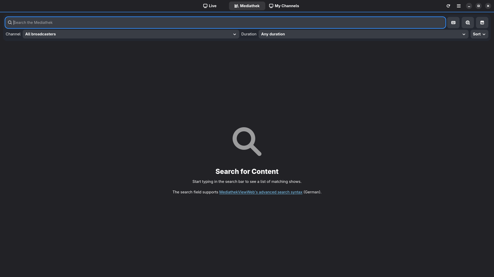
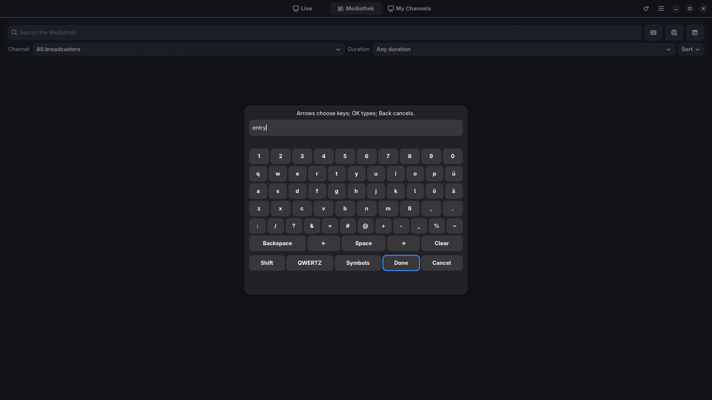
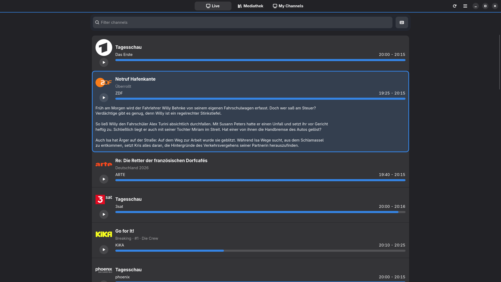
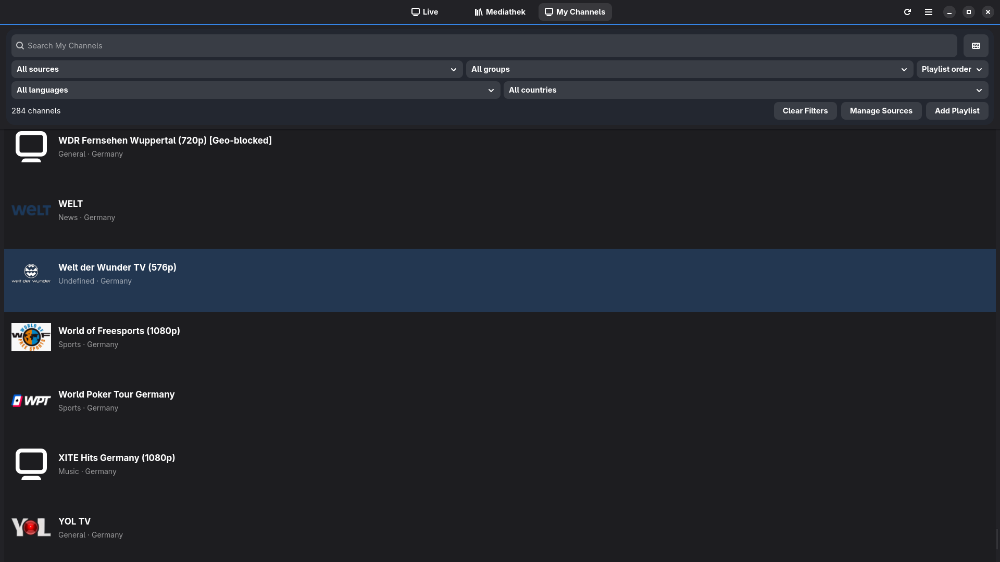

<!-- SPDX-FileCopyrightText: David Cabot <d-k-bo@mailbox.org> -->
<!-- SPDX-FileCopyrightText: 2026 Televido contributors -->
<!-- SPDX-FileCopyrightText: 2026 Broadcaster contributors -->
<!-- SPDX-FileContributor: Claude (Anthropic) -->
<!-- SPDX-License-Identifier: GPL-3.0-or-later -->

# Broadcaster

**[English](README.md) | Deutsch**

Broadcaster ist eine schlanke, native Linux-Anwendung für öffentlich-rechtliches Live-TV, Mediathek-Sendungen und eigene M3U-/IPTV-Sender. Die Wiedergabe erfolgt mit mpv. Die GTK4-/libadwaita-Oberfläche funktioniert mit Maus und Tastatur sowie mit Richtungsfernbedienungen, auch unter Wayland/KDE Plasma Bigscreen.

## Funktionen

- **Mediathek:** Suche über MediathekViewWeb, Sender- und Dauerfilter, Sortierung, Qualitätsauswahl und Sendungsdetails.
- **Live-TV:** laufende Programme aus dem Zapp-Katalog mit Sendungsbeschreibungen sowie konfigurierbarer Senderauswahl und -reihenfolge.
- **Eigene Sender (neu in v0.2.0):** Lokale M3U-Dateien oder HTTP(S)-Playlistadressen hinzufügen, mehrere Quellen verwalten, nach Gruppe/Sprache/Land/Region filtern, Sendermetadaten dauerhaft bearbeiten und Streams über die bestehende mpv-Steuerung abspielen. Senderlogos werden nur bei Bedarf geladen und können durch ein Standardsymbol ersetzt werden.
- **Bildschirmtastatur (v0.2.1):** Texteingabe mit den Richtungstasten der Fernbedienung in bearbeitbaren Feldern. Sie ist standardmäßig verfügbar und lässt sich in den Einstellungen abschalten. Maus und physische Tastatur funktionieren weiterhin.
- **Fernbedienung:** Vollbildstart und mpv-Bedienoberfläche für Pause, Sprünge, Geschwindigkeit, Tonspuren und Untertitel. Sprachbezeichnungen richten sich nach verfügbaren Metadaten.
- **Desktop:** native GTK4-Oberfläche, Englisch und Deutsch, optionaler externer Player bzw. Downloader sowie Flatpak-Pakete für x86-64 und ARM64.

## Screenshots

### Mediathek-Suche

Sendungen über die Suche sowie Sender-, Dauer- und Sortierfilter finden.



### Bildschirmtastatur

Suchbegriffe mit einer Fernbedienung eingeben, ohne eine physische Tastatur zu benötigen.



### Live-TV

Laufende Sendungen mit Fortschrittsanzeige und aufklappbaren Beschreibungen durchsuchen.



### Eigene Sender

Importierte IPTV-Sender anzeigen und nach Quelle, Gruppe, Sprache oder Land filtern.



### Videowiedergabe

Die bestehende mpv-Wiedergabesteuerung bleibt in v0.2.1 unverändert.


Weitere ältere Screenshots, auch zum Hinzufügen von Playlists, zeigt das [Release v0.2.0](https://github.com/Certain1989/Broadcaster/releases/tag/v0.2.0).

Öffentlich verfügbare Wiedergabelisten für **Eigene Sender** bietet [IPTV-org nach Land, Sprache und Kategorie](https://github.com/iptv-org/iptv/blob/master/PLAYLISTS.md). Der Dialog „Wiedergabeliste hinzufügen“ verlinkt dasselbe externe Verzeichnis; Broadcaster abonniert nichts automatisch. Heruntergeladene Senderlogos werden lokal zwischengespeichert (bis zu 2.048 Bilder oder 256 MiB). Nach erfolgreicher Aktualisierung einer Wiedergabeliste oder dem Löschen einer Quelle werden nicht mehr verwendete Logos entfernt; der kleinere Arbeitsspeicher-Cache bleibt für eine flüssige Fernbedienung begrenzt.

Broadcaster stellt selbst keine Medien bereit. Verfügbarkeit, regionale Sperren, Metadaten und Untertitel hängen von den Sendern und Katalogdiensten ab. Die Tastenbelegung variiert je nach Fernbedienung und Desktop. Fedora KDE Plasma Bigscreen unter Wayland ist die primär erprobte TV-Umgebung; eine Garantie für andere Linux-Desktops besteht nicht.

## Broadcaster installieren

Das Produktions-Flatpak für die passende Architektur und die zugehörige Datei `SHA256SUMS` vom [veröffentlichten Broadcaster-Release v0.2.1](https://github.com/Certain1989/Broadcaster/releases/tag/v0.2.1) herunterladen. Das folgende Beispiel verwendet x86_64 (Intel/AMD); für ARM64 jeweils `aarch64` einsetzen.

```bash
grep 'broadcaster-0.2.1-x86_64.flatpak$' SHA256SUMS | sha256sum -c -
flatpak remote-add --user --if-not-exists flathub https://flathub.org/repo/flathub.flatpakrepo
flatpak install --user ./broadcaster-0.2.1-x86_64.flatpak
flatpak run io.github.Certain1989.Broadcaster
```

Die Prüfsumme gleicht das heruntergeladene Flatpak mit der `SHA256SUMS`-Datei desselben Releases ab. Für ARM64 den passenden Namen in **beiden** Befehlen verwenden. Entfernen: `flatpak uninstall --user io.github.Certain1989.Broadcaster`. Für eine systemweite Installation auf einem separaten TV-Konto die Befehle `sudo flatpak remote-add --system ...`, `sudo flatpak install --system ./broadcaster-0.2.1-x86_64.flatpak` und `sudo flatpak uninstall --system ...` verwenden; die Anwendung selbst ohne sudo starten.

Die Anwendung benötigt GNOME Platform 51; Flatpak kann diese Runtime von Flathub beziehen. **Broadcaster selbst wird nicht über Flathub angeboten.** Eigenständige Flatpak-Bundles richten **keine automatischen Anwendungsupdates** ein; neuere geprüfte Versionen müssen manuell installiert werden. Die stabile App-ID unterscheidet sich von `io.github.Certain1989.Broadcaster.Devel` für Entwicklungsbuilds.


### Schwarzes Bild nach der Flatpak-Installation

Das Flatpak mit GNOME Platform 51 verwendet mpv mit den FFmpeg-Bibliotheken der Runtime. Für H.264-Wiedergabe wird die passende Freedesktop-Codec-Erweiterung `org.freedesktop.Platform.codecs-extra//26.08-extra` benötigt. Normalerweise installiert Flatpak sie automatisch. Bei einer unvollständigen Installation kann jedoch **Ton zu hören sein, während das Bild schwarz bleibt**. Codec-Erweiterungen sind an die Runtime-Version gebunden: ältere Broadcaster-Builds mit GNOME Platform 50 benötigen weiterhin `25.08-extra`. Eine neuere Erweiterung allein ersetzt die zu einer älteren Runtime passende Version nicht.

Installierte Erweiterungen anzeigen und prüfen, ob `codecs-extra` in der Broadcaster-Sandbox eingebunden ist:

```bash
flatpak list --runtime --columns=application,branch,installation | grep -E 'codecs-extra|org.gnome.Platform'
flatpak run --command=sh io.github.Certain1989.Broadcaster \
  -c "grep '^runtime-extensions=' /.flatpak-info"
```

Fehlt die für diesen Build passende Erweiterung `26.08-extra`, diese von Flathub installieren und die Videowiedergabe erneut testen:

```bash
flatpak install --user flathub org.freedesktop.Platform.codecs-extra//26.08-extra
```

Bei einer systemweiten Flatpak-Installation statt `--user` die Option `--system` verwenden (Flathub muss systemweit eingerichtet sein). Auch eine benutzerbezogene Broadcaster-Installation kann eine passende, systemweit installierte Codec-Erweiterung verwenden; **Broadcaster selbst muss nicht systemweit installiert sein**. Falls die Erweiterung vorhanden und eingebunden ist, aber weiterhin kein Bild erscheint, bitte die Flatpak-/Runtime-Versionen und einen Test mit einem öffentlichen oder synthetischen Video melden, keine privaten Stream-URLs oder Zugangsdaten.

## Aus dem Quellcode bauen (Fedora)

```bash
sudo dnf install git rust cargo meson ninja-build blueprint-compiler gettext \
  gtk4-devel libadwaita-devel glib2-devel openssl-devel pkgconf-pkg-config \
  desktop-file-utils appstream mpv
git clone https://github.com/Certain1989/Broadcaster.git
cd Broadcaster
meson setup _build -Dprofile=development --prefix="$HOME/.local"
meson compile -C _build
meson test -C _build --print-errorlogs
meson install -C _build
GSETTINGS_SCHEMA_DIR="$HOME/.local/share/glib-2.0/schemas" \
  "$HOME/.local/bin/broadcaster"
```

Weitere Prüfungen: `cargo fmt --check`, `cargo clippy --locked --all-targets -- -D warnings`, `cargo test --locked`, `lua tests/mpv-remote.lua` und `reuse lint`. Siehe [Hinweise für Beiträge](CONTRIBUTING.md). Native Builds verwenden das mpv des Systems, veröffentlichte Flatpaks bringen mpv mit Lua-Unterstützung mit.

## Wiedergabe und Einschränkungen

In der erprobten Bigscreen-Umgebung aktiviert OK/Enter Einträge und öffnet die Wiedergabesteuerung; Pfeiltasten navigieren, Zurück schließt Menüs oder kehrt zur vorherigen Ansicht zurück und Home/Stop verlassen die Wiedergabe. Bei ausgeblendeter mpv-Leiste dienen Pfeiltasten zum Springen. F11 und das Anwendungsmenü wechseln den gespeicherten Vollbildmodus. Die konkrete Steuerung hängt von der Systemkonfiguration ab.

Die reguläre mpv-Mausbedienoberfläche kann bei manchen Wayland-Starts kurz aufblitzen; dies ist eine akzeptierte kosmetische Einschränkung. Bezeichnungen für Ton- und Untertitelspuren hängen von den Stream-Metadaten ab. Die Anwendungsoberfläche wird auf Englisch und Deutsch angeboten. Weitere Übersetzungen werden derzeit nicht mitgeliefert.

## Entwicklung, Wartung und Lizenzen

Erhebliche Teile der Implementierung, Tests und Überprüfung entstanden mit Unterstützung großer Sprachmodelle. Automatisierte Tests und praktische Erprobung stellen keine unabhängige Zertifizierung oder Garantie für Fehlerfreiheit dar.

Broadcaster ist ein Hobbyprojekt und wird **wie besehen** unter Berücksichtigung der anwendbaren Lizenzbedingungen und Gesetze angeboten. Es bestehen keine garantierten Reaktionszeiten, Wartungsintervalle, Funktionszusagen oder allgemeine Kompatibilitätsgarantien. Aus Fehlerberichten bitte Zugangsdaten, Tokens und private Stream-URLs entfernen. Siehe [Sicherheitsmeldungen](SECURITY.md) und [technische Übersicht](docs/maintenance-baseline.md).

Der Programmcode steht unter **GPL-3.0-or-later**; einzelne Ressourcen und übernommene MIT-Bestandteile haben eigene Lizenzen. Das dezente Broadcaster-Icon wurde mit ChatGPT erzeugt und wird, soweit Schutzrechte bestehen, unter CC BY 4.0 angeboten; Marken- und Endorsementrechte sind davon nicht umfasst. Siehe `COPYING`, `LICENSES/`, `REUSE.toml` und [Grafiken und Herkunft](docs/artwork-and-attribution.md).

Broadcaster enthält angepassten Code aus [Televido](https://github.com/d-k-bo/televido) und [Televido-Fritz](https://github.com/45054/televido-fritz), ursprünglich unter GPL-3.0-or-later. Urhebervermerke und anwendbare Lizenzen bleiben erhalten. Die Vorgängerprojekte unterstützen Broadcaster nicht offiziell; dieses neue öffentliche Quellrepository enthält nicht deren vollständige Git-Historie.
