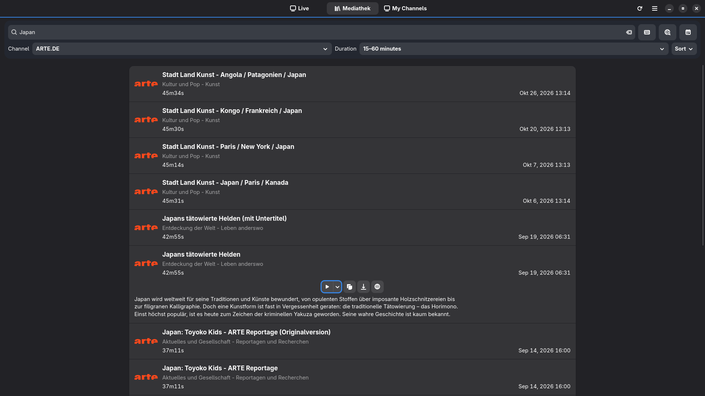
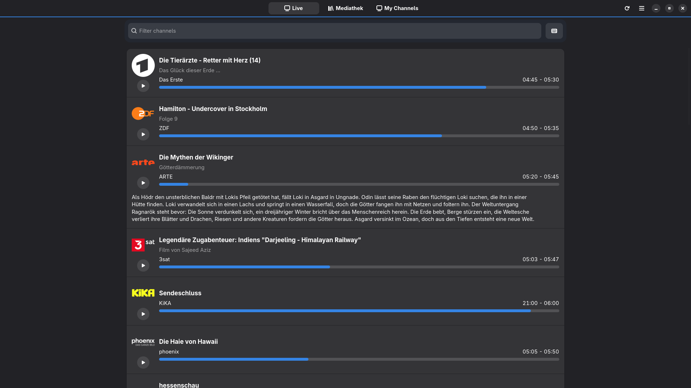
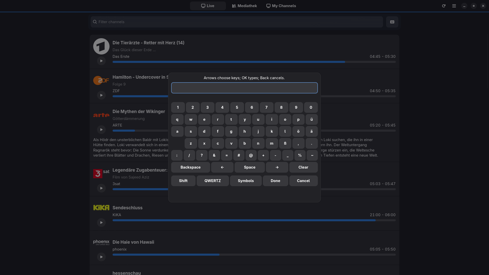
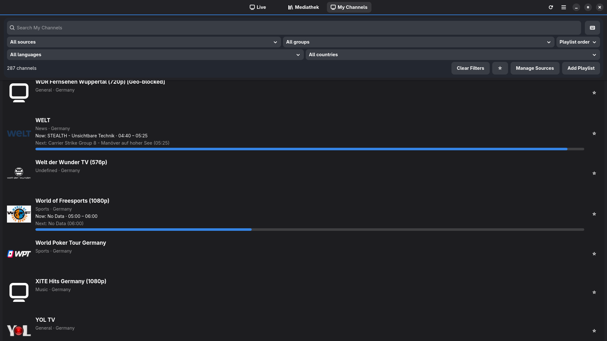
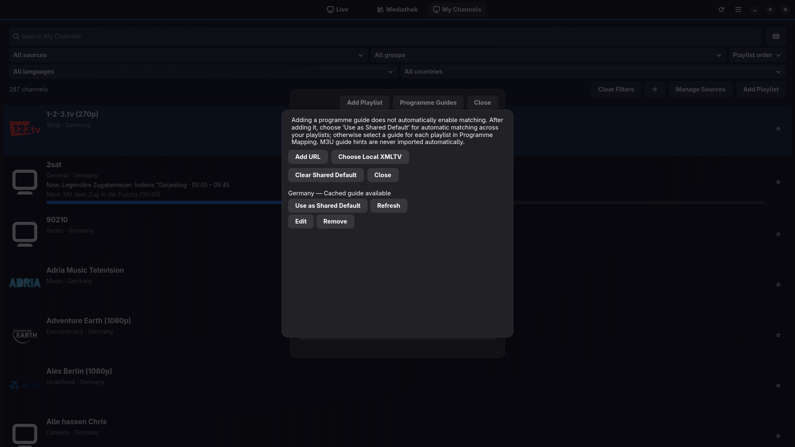

<!-- SPDX-FileCopyrightText: David Cabot <d-k-bo@mailbox.org> -->
<!-- SPDX-FileCopyrightText: 2026 Televido contributors -->
<!-- SPDX-FileCopyrightText: 2026 Broadcaster contributors -->
<!-- SPDX-FileContributor: Claude (Anthropic) -->
<!-- SPDX-License-Identifier: GPL-3.0-or-later -->

# Broadcaster

**English | [Deutsch](README.de.md)**

Broadcaster is a lightweight, native Linux application for German public-service live TV, on-demand Mediathek programmes and your own M3U/IPTV channels, all played with mpv. Optional XMLTV programme guides add **Now/Next information** to My Channels, while **favourites** make personal channel lists easier to navigate. Its GTK4/libadwaita interface works with a mouse, keyboard or directional television remote, including on Wayland/KDE Plasma Bigscreen.

## What it does

- **Mediathek:** search German-language broadcaster catalogues through MediathekViewWeb. Filter by channel or duration, sort results, choose stream quality, and open programme details.
- **Live TV:** browse current programmes from the Zapp service, read programme descriptions, and select which live channels appear and in what order.
- **My Channels (new in v0.2.0):** add local M3U files or HTTP(S) playlist addresses, manage multiple sources, refresh playlists manually, filter by group/language/country/region, edit channel metadata without losing it on refresh, and play streams with the same mpv controls. Channel logos are fetched only as needed and may fall back to a generic icon.
- **XMLTV programme guides (v0.2.5):** add multiple XMLTV guide sources from local files or explicitly chosen HTTP(S) URLs. Refresh them manually or on an optional per-guide schedule (enabled by default when adding a guide). Choose one **Shared Default** for playlists or assign a guide to an individual playlist. Merely adding a guide does not associate it with a playlist.
- **Playlist guide choice (v0.3.0):** each playlist can inherit the Shared Default, use a particular programme guide or explicitly display no guide information. Individual choices do not affect other playlists.
- **Automatic playlist refresh (v0.3.0):** optional per-source M3U refresh, disabled by default, with a 6–168-hour interval. Broadcaster checks due playlists while running; unexpectedly large channel-list shrinkage requires manual confirmation.
- **Database backup and restore (v0.3.0):** export a consistent SQLite snapshot to a chosen folder; import a compatible backup only as an explicitly confirmed full database replacement after restarting the application. The previous database is retained for recovery.
- **Now/Next and channel matching (v0.2.5):** see current and upcoming programme information in My Channels when a guide has been selected and a channel match is available. Exact IDs and certain corroborated identity variants match automatically; name-based suggestions require confirmation. Review ambiguous matches and override regional variants manually.
- **Favourites (v0.2.5):** mark IPTV channels with a star and use the favourites-only filter. Favourites and channel metadata are preserved separately from programme-guide associations.
- **Remote navigation (v0.2.5):** improved directional focus and remote access to card actions, favourites, source and guide managers, channel editing and the on-screen keyboard.
- **On-screen keyboard (v0.2.1):** enter text using directional remote keys wherever an editable field offers the keyboard; it is available by default and can be disabled in Settings. Mouse and physical keyboard input still work.
- **TV controls:** fullscreen startup, remote-friendly navigation, and a dedicated mpv overlay for play/pause, seeking, playback speed, audio tracks and subtitles. Labels reflect available stream metadata. In v0.3.2 the overlay's D-pad focus follows spatial button positions rather than row indices.
- **Desktop integration:** native GTK4 interface, English and German text, optional external player and downloader, and Flatpak builds for x86-64 and ARM64.

## Network access and playlist consent (v0.3.1)

Broadcaster checks untrusted remote playlist, programme-guide and logo requests against network-destination and redirect rules. **Private-LAN access for each HTTP(S) playlist is disabled by default.** If a trusted playlist really needs a private address, use **Add Playlist** or **Edit Source Defaults** and explicitly enable **Allow this playlist to connect to private LAN addresses (explicit opt-in)**. Permission applies only to that source and exact URL; changing the URL requires a new choice. Scheduled playlist refresh requires the current permission and does not override a revocation. XMLTV guides have their own explicit rules; playlist permission does not permit every imported stream or nested media resource.

When revocation cannot be saved, Broadcaster reports an error and blocks LAN access for that process. **If every persistent write fails**, an old GSettings grant may reappear after restart: restore writable storage and retry revocation before exiting. This limitation and the scope of mpv/external player access are documented in [network trust](docs/network-trust.md) and the [threat model](docs/threat-model.md). Do not publish sensitive playlist URLs or tokens in issue reports.

## Using XMLTV programme guides

Guides are **optional**. Broadcaster does not automatically download a guide URL suggested by an M3U playlist. To show Now/Next information for your channels:

1. Add a local or HTTP(S) M3U playlist in **My Channels**.
2. Open the EPG source manager, add an XMLTV file or HTTP(S) guide URL you are permitted to use, then select **Refresh** to import it immediately.
3. Select it as the **Shared Default** for your playlists, or choose a guide for a specific playlist. You can also explicitly select **no guide** for a playlist. One shared guide can serve multiple playlists. **Adding an EPG source alone is not enough.**
4. Check the channel matches. Exact IDs and certain corroborated identity variants can match automatically; confirm name-based suggestions or manually override uncertain matches, especially regional variants.
5. Return to **My Channels** to view available Now/Next information and star channels you want in the favourites filter.

New guides have **automatic refresh enabled by default** in the Add Guide dialog, with a 24-hour age threshold. You can turn this off when adding a guide or change the interval (6–168 hours) in guide settings. Broadcaster checks due, enabled guides when the guide service starts and approximately once a minute **while the app is running**; it does not update them while closed. Manual guide refresh remains available. **M3U playlists have a separate optional refresh schedule**, configured for each source in Manage Sources. It is disabled by default; when enabled, the interval is 6–168 hours, and updates are checked only while Broadcaster runs. Unexpectedly large channel-list shrinkage requires manual confirmation. The XMLTV guide scheduler does not refresh M3U playlists.

A missing or failed guide import must not stop ordinary channel playback or Mediathek use. Now/Next is not a full programme-grid EPG, and externally supplied listings may be incomplete. See the [v0.3.2 release notes](docs/release-v0.3.2-notes.md) for the latest changes and limitations.

For details on private recovery snapshots, disk limits and abandoned guide downloads, see [EPG/SQLite storage operations](docs/epg-sqlite-storage.md).

## Database backup, restore and application upgrades

In **My Channels → Manage Sources → Backup / Restore**, select **Export Complete Database** and choose a **writable folder**. Broadcaster asks for access to the selected folder—not a single output file—so it can create and verify a uniquely named `broadcaster-backup-*.sqlite3` snapshot without overwriting an existing backup. This includes playlists, channels, favourites, guide associations, cached programme data and database refresh settings. It may also contain **private URLs, paths and access tokens**, so store it securely. The export does **not** contain external M3U/XMLTV files, downloaded artwork, GSettings preferences or Flatpak document-portal permissions.

**Import and Replace Database** validates a selected compatible snapshot and displays its playlist, channel, guide and cached-programme counts. Confirm **Replace Entire Database After Restart** only when you intend to replace **all** current database data: it is **not a merge**. Close and restart Broadcaster to apply the replacement before normal database use; do not start another source refresh between confirmation and closing. The previous database is kept as a private recovery copy, and local files may need reauthorization after restoring.

**A normal application upgrade does not require database export or import.** Close Broadcaster, verify and install the newer production Flatpak into the same `--user` or `--system` scope, and start the app. Supported older SQLite data is migrated automatically. Keep a separate backup if the data matters to you; do not uninstall with data deletion as an upgrade step. See the [v0.3.2 release notes](docs/release-v0.3.2-notes.md) for details and limitations.

## Screenshots

The following screenshots were captured in v0.2.5 and remain representative of the largely unchanged v0.3.2 interface. New playlist-refresh and database backup/restore dialogs are not pictured. Programme titles, times and IPTV availability come from third-party sources and can change.

### Mediathek search

Search the Mediathek using a title, broadcaster and duration filters.



### Live TV

Browse currently airing programmes with progress indicators and descriptions.



### On-screen keyboard

Enter text with a directional remote without needing a physical keyboard.



### My Channels with programme information

Browse your IPTV channels, filter your lists and view XMLTV Now/Next information when available.



### Programme Guides

Manage explicitly selected XMLTV guide sources, refresh a guide or choose the shared default.



### Video playback

This screenshot shows an earlier version of the integrated mpv controls. In v0.3.2, directional focus follows on-screen button positions; the visible control layout is unchanged.


See the [v0.2.0 release](https://github.com/Certain1989/Broadcaster/releases/tag/v0.2.0) for historical screenshots, including playlist setup.

To find playlists for **My Channels**, browse [IPTV-org's country, language and category playlists](https://github.com/iptv-org/iptv/blob/master/PLAYLISTS.md). The Add Playlist dialog links to the same third-party directory; nothing is subscribed automatically. Imported logos are cached on disk (up to 2,048 images or 256 MiB) and unreferenced images are removed after successful playlist refreshes or source deletion; memory textures remain deliberately small to keep remote input responsive.

Broadcaster neither hosts nor supplies media. Stream availability, channel metadata, subtitles, regional restrictions and service uptime are controlled by broadcasters and external catalogue providers. Remote key mapping depends on your desktop and hardware; Fedora KDE Plasma Bigscreen/Wayland is the primary tested TV environment. Other Linux desktops may work but are not guaranteed.

The [v0.3.2 release notes](docs/release-v0.3.2-notes.md) describe the maintenance update, spatial playback controls and compatibility limits; the [v0.2.5 notes](docs/release-v0.2.5-notes.md) remain available for the earlier guide release. Download the published production Flatpak for your architecture, and verify its checksum before installation.

## Install Broadcaster

Download the production Flatpak for your architecture and the matching `SHA256SUMS` from the [Broadcaster v0.3.2 release page](https://github.com/Certain1989/Broadcaster/releases/tag/v0.3.2) (once publication is complete). The example below uses Intel/AMD x86_64; use `aarch64` for ARM64. The same `--or-update` command installs Broadcaster for the first time or updates an existing installation in the selected scope.

```bash
grep 'broadcaster-0.3.2-x86_64.flatpak$' SHA256SUMS | sha256sum -c -
flatpak remote-add --user --if-not-exists flathub https://flathub.org/repo/flathub.flatpakrepo
flatpak install --user --or-update ./broadcaster-0.3.2-x86_64.flatpak
flatpak run io.github.Certain1989.Broadcaster
```

For ARM64 (`aarch64`), use these matching commands instead:

```bash
grep 'broadcaster-0.3.2-aarch64.flatpak$' SHA256SUMS | sha256sum -c -
flatpak install --user --or-update ./broadcaster-0.3.2-aarch64.flatpak
```

The checksum command checks the downloaded bundle against the release's `SHA256SUMS`; use the corresponding ARM64 filename in **both** commands when applicable. For removal use `flatpak uninstall --user io.github.Certain1989.Broadcaster`. To install or update system-wide for a separate TV account, configure Flathub for system runtime dependencies and use `sudo flatpak install --system --or-update ./broadcaster-0.3.2-x86_64.flatpak`; start the app without sudo. Use **the same scope** as the existing installation when upgrading. `--user` and `--system` installations have separate deployment scopes; do not uninstall or delete application data to upgrade.

Broadcaster uses GNOME Platform 51, which Flatpak can obtain from Flathub. **Broadcaster itself is not distributed via Flathub.** Standalone Flatpak bundles do **not** configure automatic application updates; install later verified releases manually. The stable app ID above is different from `io.github.Certain1989.Broadcaster.Devel` used by CI development builds.


### Black video after installing the Flatpak

The GNOME Platform 51 Flatpak uses mpv with the runtime's FFmpeg libraries. H.264 playback requires the matching Freedesktop codec extension, `org.freedesktop.Platform.codecs-extra//26.08-extra`. Flatpak normally installs this automatically, but an incomplete installation can result in **audio playing while the video stays black**. Codec extensions are versioned by runtime: earlier Broadcaster builds using GNOME Platform 50 require `25.08-extra` instead; merely having the newer extension installed cannot satisfy an older runtime.

Check the installed extensions and whether the running Broadcaster sandbox mounts `codecs-extra`:

```bash
flatpak list --runtime --columns=application,branch,installation | grep -E 'codecs-extra|org.gnome.Platform'
flatpak run --command=sh io.github.Certain1989.Broadcaster \
  -c "grep '^runtime-extensions=' /.flatpak-info"
```

If the matching `26.08-extra` extension is absent for this build, install it from Flathub and retry video playback:

```bash
flatpak install --user flathub org.freedesktop.Platform.codecs-extra//26.08-extra
```

For a system-wide Flatpak installation, use `--system` instead of `--user` (with Flathub configured system-wide). A per-user Broadcaster installation can also use a matching system-installed codec extension; **Broadcaster itself does not need to be installed system-wide**. If the extension is present and mounted but video still fails, report the Flatpak/runtime versions and a test with a public or synthetic video, not private stream URLs or credentials.

## Build from source (Fedora example)

```bash
sudo dnf install git rust cargo meson ninja-build blueprint-compiler gettext \
  gtk4-devel libadwaita-devel glib2-devel openssl-devel pkgconf-pkg-config \
  desktop-file-utils appstream mpv
git clone https://github.com/Certain1989/Broadcaster.git
cd Broadcaster
meson setup _build -Dprofile=development --prefix="$HOME/.local"
meson compile -C _build
meson test -C _build --print-errorlogs
meson install -C _build
GSETTINGS_SCHEMA_DIR="$HOME/.local/share/glib-2.0/schemas" \
  "$HOME/.local/bin/broadcaster"
```

Use `cargo fmt --check`, `cargo clippy --locked --all-targets -- -D warnings`, `cargo test --locked`, `lua tests/mpv-remote.lua`, and `reuse lint` for further checks. See [contribution guidance](CONTRIBUTING.md). Native builds use the host's mpv; release Flatpaks bundle mpv with Lua support.

## Playback and known limitations

On the tested Bigscreen setup, OK/Enter activates items and opens the playback controls; arrows navigate, Back closes open overlays or returns to the previous view, and Home/Stop leave playback. With the playback overlay hidden, the directional arrows can seek. F11 or the application menu toggles saved fullscreen state. Exact bindings depend on your remote and compositor.

The stock mpv mouse overlay can briefly flash at startup on some Wayland sessions; this is an accepted cosmetic limitation. Audio/subtitle labels are only as accurate as the stream metadata. The application interface is provided in English and German. Other translations are not currently shipped.

## Development, maintenance and licensing

Substantial implementation, testing and review used large language models. Automated checks and practical testing do not constitute independent certification or a guarantee against defects.

Broadcaster is a hobby project provided **as-is**, subject to the applicable licence and law. There is no promised issue response time, maintenance schedule, future feature development or universal platform compatibility. Please remove credentials, tokens and private stream URLs from issue reports. See [security reporting](SECURITY.md) and the [technical overview](docs/maintenance-baseline.md).

Application code is distributed under **GPL-3.0-or-later**, with some separately licensed assets and MIT-licensed inherited material. The subdued Broadcaster app icon was generated with ChatGPT and is offered under CC BY 4.0 to the extent protectable rights exist; this does not grant trademark or endorsement rights. See `COPYING`, `LICENSES/`, `REUSE.toml` and [artwork and attribution](docs/artwork-and-attribution.md).

Broadcaster incorporates and adapts code from [Televido](https://github.com/d-k-bo/televido) and [Televido-Fritz](https://github.com/45054/televido-fritz), originally under GPL-3.0-or-later. Original copyright notices and applicable third-party licences are retained. These upstream projects do not endorse Broadcaster; this clean public source repository does not contain their complete inherited Git history.
