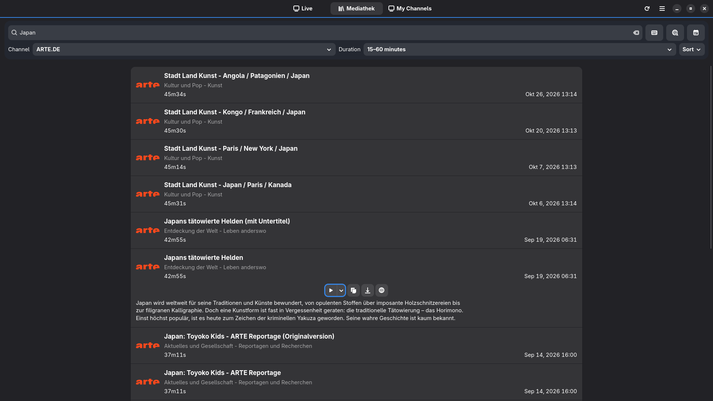
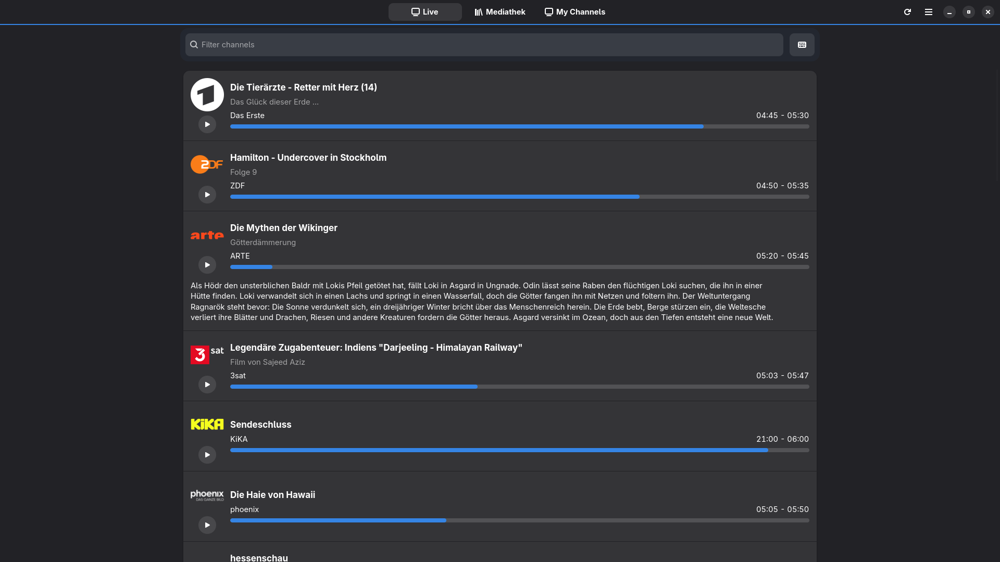
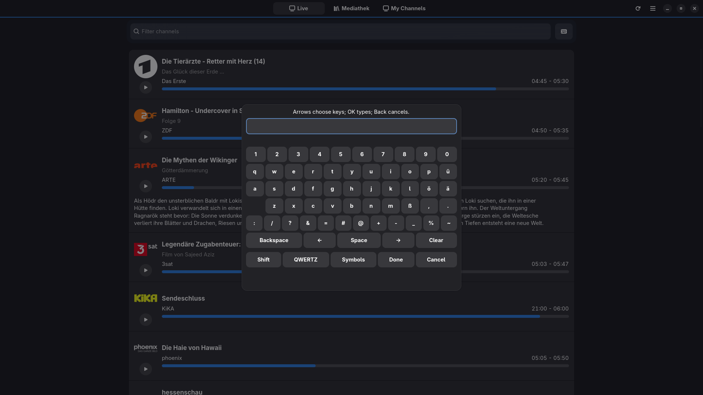
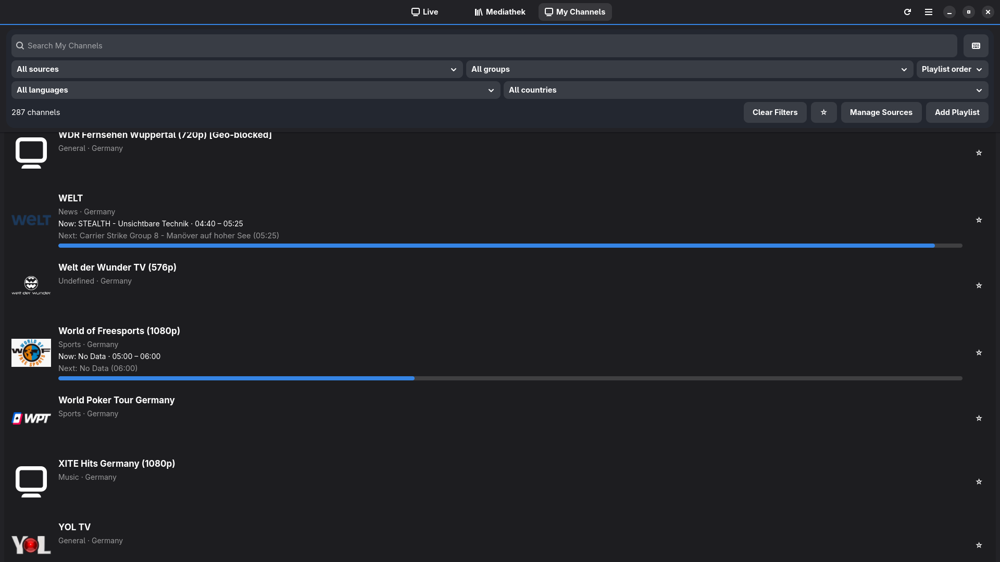
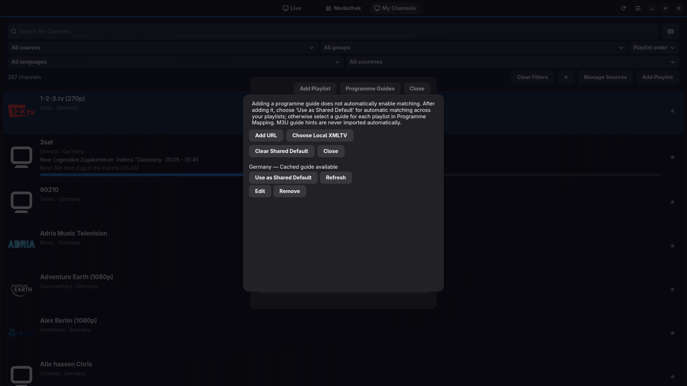

<!-- SPDX-FileCopyrightText: 2026 Broadcaster contributors -->
<!-- SPDX-License-Identifier: GPL-3.0-or-later -->

# Broadcaster v0.3.0 — Versionshinweise

Broadcaster v0.3.0 ergänzt die Verwaltung eigener M3U-Playlists um eine optionale automatische Aktualisierung, flexiblere Programmführer-Zuordnungen pro Playlist sowie die vollständige Sicherung und Wiederherstellung der SQLite-Datenbank. Die XMLTV-Verarbeitung und die Bereinigung von Zwischendateien wurden ebenfalls verbessert. Mediathek, Live-TV, Favoriten, Jetzt/Nächste und die mpv-Wiedergabe bleiben erhalten.

## Änderungen

- **Automatische Playlist-Aktualisierung:** Unter **Eigene Sender → Quellen verwalten → Automatic Playlist Refresh** lässt sich die Aktualisierung für jede M3U-Quelle einzeln aktivieren. Sie ist **standardmäßig ausgeschaltet**; das Intervall beträgt 6–168 Stunden. Fällige Playlists werden nur geprüft, **während Broadcaster läuft**. Die manuelle Aktualisierung bleibt möglich. Bei einem unerwartet großen Verlust von Sendern wird eine manuelle Bestätigung verlangt, statt die Änderung ungefragt zu übernehmen.
- **Programmführer pro Playlist:** Eine Playlist kann den **Shared Default** übernehmen, einen bestimmten XMLTV-Programmführer verwenden oder sich ausdrücklich für **keinen Programmführer** entscheiden. Andere Playlists bleiben davon unberührt. Das bloße Hinzufügen einer EPG-Quelle stellt weiterhin keine Zuordnung her; unsichere Sendertreffer müssen geprüft werden.
- **Vollständige Datenbanksicherung und -wiederherstellung:** Die SQLite-Datenbank mit Playlists, Sendern, Favoriten, EPG-Zuordnungen, zwischengespeicherten Sendungen und Aktualisierungseinstellungen lässt sich konsistent exportieren. Ein Import ist ein ausdrücklich zu bestätigender **vollständiger Ersatz** und **keine Zusammenführung**. Die Wiederherstellung wird nach Schließen und Neustart der Anwendung durchgeführt.
- **XMLTV-Kompatibilität:** Problematische Steuerzeichen in Sendungstiteln können sicher ausgelassen werden. Zusätzliche Tests decken auch große Programmführer ab. Externe Programmdaten können weiterhin unvollständig oder fehlerhaft sein.
- **Speicherbetrieb und Fernbedienung:** Verwaiste XMLTV-Zwischendateien werden unter Beachtung aktiver Sperren begrenzt bereinigt. Historische Wiederherstellungskopien von Datenbankmigrationen bleiben erhalten. Weitere Regressionstests decken Quellenverwaltung und Fernbedienungsnavigation ab.

## Screenshots

Diese Screenshots stammen aus v0.2.5 und zeigen die im Wesentlichen unveränderte Oberfläche von v0.3.0. Die neuen Dialoge für die automatische Playlist-Aktualisierung und die Datenbanksicherung sind darauf nicht abgebildet.

### Mediathek-Suche

### Live-TV

### Bildschirmtastatur

### Eigene Sender mit Jetzt/Nächste

### Programmführer

## Datenbank sichern und wiederherstellen

Unter **Eigene Sender → Quellen verwalten → Backup / Restore** stehen beide Funktionen bereit.

Für eine Sicherung **Export Complete Database** wählen und im Dateidialog einen **beschreibbaren Ordner** auswählen. Broadcaster benötigt Zugriff auf diesen ausdrücklich gewählten Ordner, um eine überprüfte Datei mit eindeutigem Namen wie `broadcaster-backup-<zufällige-id>.sqlite3` anzulegen. Es wird also ein **Ordner**, keine einzelne Zieldatei ausgewählt; vorhandene Sicherungen werden nicht überschrieben.

Für die Wiederherstellung **Import and Replace Database** wählen, eine kompatible Broadcaster-SQLite-Sicherung auswählen und die angezeigten Anzahlen von Playlists, Sendern, Programmführern und zwischengespeicherten Sendungen prüfen. **Replace Entire Database After Restart** nur bestätigen, wenn **alle bisherigen Datenbankinhalte** ersetzt werden sollen. Anschließend Broadcaster schließen und neu starten: Die Wiederherstellung geschieht vor dem regulären Datenbankzugriff beim nächsten Start. Zwischen Bestätigung und Schließen keine weitere Playlist- oder EPG-Aktualisierung durchführen. Die bisherige Datenbank bleibt als private Wiederherstellungskopie erhalten; automatische Aktualisierungen werden beim Wiederherstellungsstart ausgesetzt.

**Sicherungen enthalten möglicherweise vertrauliche Daten**, darunter Playlist- und EPG-Adressen, lokale Pfade, Zugangstokens und Programmdaten. Sie müssen entsprechend geschützt werden. **Nicht enthalten** sind externe M3U-/XMLTV-Dateien, heruntergeladene Grafiken, GSettings-Einstellungen und Flatpak-Dokumentenportal-Berechtigungen. Lokale Dateien müssen nach einer Wiederherstellung gegebenenfalls erneut berechtigt werden. Die Sicherungsfunktionen dienen der Wiederherstellung oder Übertragung vorhandener Daten; für ein **normales Anwendungsupdate sind sie nicht erforderlich**.

## Installation

Das veröffentlichte Produktions-Flatpak für die passende Architektur (`x86_64` oder `aarch64`) zusammen mit `SHA256SUMS` aus den [GitHub Releases](https://github.com/Certain1989/Broadcaster/releases) herunterladen und die Prüfsumme kontrollieren. Das neue Flatpak im **gleichen Installationsbereich** (`--user` oder `--system`) wie die vorhandene Installation installieren. Die Anwendungsdaten bleiben normalerweise bestehen; eine unterstützte ältere Datenbank wird beim ersten Start migriert. **Broadcaster für ein Upgrade nicht deinstallieren und die Daten nicht löschen.**

Vollständige Befehle für Prüfsumme, Installation und Upgrade stehen in der [deutschen README](../README.de.md) beziehungsweise der [englischen README](../README.md). Broadcaster wird als eigenständiges Flatpak über GitHub Releases und **nicht über Flathub** angeboten; Abhängigkeiten wie GNOME Platform 51 können von Flathub stammen. Eigenständige Flatpak-Bundles richten **keine automatischen Anwendungsupdates** ein. Das experimentelle signierte Update-Repository ist **nicht Bestandteil** von v0.3.0.

## Hinweise und Einschränkungen

Playlist- und XMLTV-Aktualisierungen werden unabhängig voneinander konfiguriert und laufen nicht bei geschlossener Anwendung. Eine M3U-Playlist berechtigt Broadcaster nicht automatisch zum Herunterladen einer darin vorgeschlagenen EPG-Adresse. Jetzt/Nächste benötigt weiterhin einen ausgewählten Programmführer und eine passende Senderzuordnung; ein vollständiger Programmplan ist nicht enthalten. Externe Anbieter bestimmen Verfügbarkeit und Richtigkeit ihrer Daten.

Historische Datenbank-Wiederherstellungskopien können **frühere URLs oder Zugangsdaten** enthalten, obwohl diese in der aktuellen Datenbank bereits gelöscht wurden. Sie werden nicht automatisch entfernt. Speicherbereinigung und Größenprüfungen bilden keine garantierte Gesamtobergrenze oder sichere Datenlöschung. Ein allgemeiner Schutz gegen böswillige Dateisystemänderungen unter demselben Benutzerkonto oder ein realer Stromausfalltest wird nicht behauptet.

Broadcaster stellt keine Medien, Playlist-Abonnements oder Programmführer bereit. Nur Quellen verwenden, für die eine Nutzungsberechtigung besteht. Das Hobbyprojekt wird ohne feste Wartungszusagen oder allgemeine Gerätekompatibilitätsgarantie bereitgestellt. Bestehende Urheberrechts- und Lizenzhinweise gelten weiterhin.
